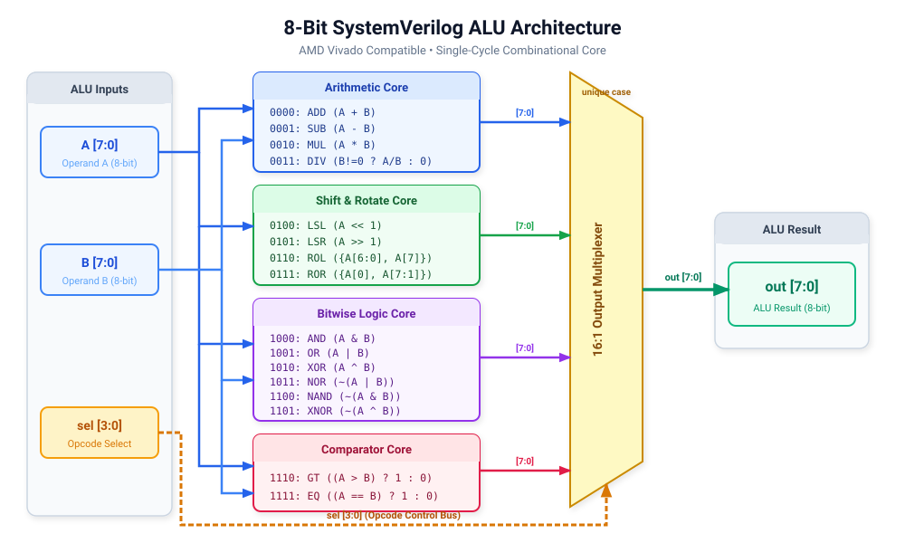

# 8-Bit Parameterized SystemVerilog ALU

A synthesizable 8-bit Arithmetic Logic Unit (ALU) implemented in modern **SystemVerilog** and verified with a linear self-checking testbench on **AMD/Xilinx Vivado Simulator (`xsim`)**.

---

## 1. Directory Structure

```text
alu_systemverilog/
├── src/
│   └── alu.sv                              # Synthesizable SystemVerilog ALU RTL
├── tb/
│   └── alu_tb.sv                           # Linear self-checking testbench
├── constraints/
│   └── alu.xdc                             # SDC/XDC timing constraints (virtual clock & I/O delays)
├── scripts/
│   └── run_pnr.tcl                         # Non-project batch synthesis & PnR script
├── reports/                                # Generated physical reports (utilization, STA, power)
├── checkpoints/                            # Vivado checkpoints (alu_synth.dcp, alu_routed.dcp)
├── diagrams/
│   ├── alu_architecture.svg                # Vector architecture schematic
│   └── alu_architecture.drawio             # Editable schematic source for Draw.io
├── Makefile                                # Build & run automation (all, run, syn, clean)
├── run_sim.bat                             # 1-Click Windows simulation script
├── run_synth_pnr.bat                       # 1-Click Windows synthesis & PnR script
├── README.md                               # Project documentation
└── SYNTHESIS_AND_PHYSICAL_DESIGN_GUIDE.md  # In-depth Vivado implementation & STA guide
```

---

## 2. ALU Architecture & Block Diagram

The ALU evaluates operations in parallel across four specialized execution cores. A 16:1 multiplexer selects the final output based on the 4-bit opcode `sel[3:0]`.

### Visual Architecture Diagram



---

## 3. Operation Truth Table

| `sel[3:0]` | Opcode | Operation | Expression | Hardware Description |
|:---:|:---:|:---:|:---|:---|
| `4'b0000` | `ADD`  | Addition | `out = A + B` | Unsigned 8-bit addition with modulo-256 overflow |
| `4'b0001` | `SUB`  | Subtraction | `out = A - B` | Unsigned 8-bit subtraction with 2's complement wrap |
| `4'b0010` | `MUL`  | Multiplication | `out = A * B` | Low 8 bits of 16-bit product |
| `4'b0011` | `DIV`  | Division | `out = (B != 0) ? A / B : 0` | Hardware division; clamps to `8'h00` if `B == 0` |
| `4'b0100` | `LSL`  | Logical Shift Left | `out = A << 1` | Zero enters LSB, MSB discarded |
| `4'b0101` | `LSR`  | Logical Shift Right | `out = A >> 1` | Zero enters MSB, LSB discarded |
| `4'b0110` | `ROL`  | Rotate Left | `out = {A[6:0], A[7]}` | MSB wrapped into LSB |
| `4'b0111` | `ROR`  | Rotate Right | `out = {A[0], A[7:1]}` | LSB wrapped into MSB |
| `4'b1000` | `AND_` | Bitwise AND | `out = A & B` | Bit-by-bit logical conjunction |
| `4'b1001` | `OR_`  | Bitwise OR | `out = A \| B` | Bit-by-bit logical disjunction |
| `4'b1010` | `XOR_` | Bitwise XOR | `out = A ^ B` | Bit-by-bit difference/parity check |
| `4'b1011` | `NOR_` | Bitwise NOR | `out = ~(A \| B)` | Inverted OR gate |
| `4'b1100` | `NAND_`| Bitwise NAND | `out = ~(A & B)` | Inverted AND gate |
| `4'b1101` | `XNOR_`| Bitwise XNOR | `out = ~(A ^ B)` | Equivalence gate |
| `4'b1110` | `GT`   | Greater-Than | `out = (A > B) ? 8'd1 : 8'd0` | Magnitude comparison |
| `4'b1111` | `EQ`   | Equality | `out = (A == B) ? 8'd1 : 8'd0`| Equality comparison |

---

## 4. Testbench & Unique Test Cases

The linear testbench (`tb/alu_tb.sv`) applies directed stimuli step-by-step with `#10` delays. It automatically checks each output, increments `total`, `passed`, or `failed` counters, and logs the results.

### Test Groups Covered:
1. **Test 1 & Test 2: Baseline Functionality**
   - Exhaustive 16-operation validation with $A = 10, B = 5$ and $A = 5, B = 10$.
2. **Test 3: Division Corner Cases**
   - **Division by Zero Protection**: $50 / 0 = 0$, $0 / 0 = 0$, $255 / 0 = 0$.
   - **Identity & Self-Division**: $255 / 1 = 255$, $255 / 255 = 1$, $0 / 25 = 0$.
3. **Test 4: Arithmetic Overflows & Underflows**
   - **Addition Wrap**: $250 + 10 = 4$ ($260 \pmod{256}$), $255 + 1 = 0$, $255 + 255 = 254$.
   - **Subtraction Wrap**: $0 - 1 = 255$, $0 - 255 = 1$, $128 - 128 = 0$.
   - **Multiplication Truncation**: $16 \times 16 = 0$ ($256 \pmod{256}$), $255 \times 255 = 1$ ($65025 \pmod{256} = 1$).
4. **Test 5: Shift vs. Rotate Differences**
   - Tests $A = 8'\text{h81}$ (`1000_0001`):
     - `LSL`: Discards MSB $\rightarrow 8'\text{h02}$ (`0000_0010`).
     - `ROL`: Rotates MSB into LSB $\rightarrow 8'\text{h03}$ (`0000_0011`).
     - `LSR`: Discards LSB $\rightarrow 8'\text{h40}$ (`0100_0000`).
     - `ROR`: Rotates LSB into MSB $\rightarrow 8'\text{hC0}$ (`1100_0000`).
5. **Test 6: Bitwise Checkerboard Patterns**
   - Tests complementary bit patterns ($A = 8'\text{hAA}$, $B = 8'\text{h55}$) to thoroughly verify De Morgan's laws and all bitwise gates.
6. **Test 7: Comparison Boundary Checks**
   - Evaluates off-by-one and boundary conditions: $128 == 128$, $128 > 127$, $127 > 128$, $255 > 0$, $0 > 255$, $0 == 0$, $255 == 255$.

---

## 5. Execution Guide

### Using `make` (Command Line)
```bash
# Run complete simulation
make all

# Individual simulation stages
make compile      # xvlog -sv src/alu.sv tb/alu_tb.sv
make elaborate    # xelab -debug typical alu_tb -s alu_sim
make run          # xsim alu_sim -R

# Run complete Synthesis, Place & Route, and STA flow
make syn

# Clean all build outputs
make clean
```

### Windows One-Click Batch
```powershell
# 1. Run simulation
.\run_sim.bat

# 2. Run synthesis, placement, routing & timing analysis
.\run_synth_pnr.bat
```

---

## 6. Simulation Output

```text
ALU TESTBENCH STARTED

--- Test 1: A=10, B=5 ---
PASS | sel=0000 | A= 10 | B=  5 | Out= 15
PASS | sel=0001 | A= 10 | B=  5 | Out=  5
PASS | sel=0010 | A= 10 | B=  5 | Out= 50
PASS | sel=0011 | A= 10 | B=  5 | Out=  2
PASS | sel=0100 | A= 10 | B=  5 | Out= 20
PASS | sel=0101 | A= 10 | B=  5 | Out=  5
PASS | sel=0110 | A= 10 | B=  5 | Out= 20
PASS | sel=0111 | A= 10 | B=  5 | Out=  5
PASS | sel=1000 | A= 10 | B=  5 | Out=  0
PASS | sel=1001 | A= 10 | B=  5 | Out= 15
PASS | sel=1010 | A= 10 | B=  5 | Out= 15
PASS | sel=1011 | A= 10 | B=  5 | Out=240
PASS | sel=1100 | A= 10 | B=  5 | Out=255
PASS | sel=1101 | A= 10 | B=  5 | Out=240
PASS | sel=1110 | A= 10 | B=  5 | Out=  1
PASS | sel=1111 | A= 10 | B=  5 | Out=  0

--- Test 2: A=5, B=10 ---
PASS | sel=0000 | A=  5 | B= 10 | Out= 15
PASS | sel=0001 | A=  5 | B= 10 | Out=251
PASS | sel=0010 | A=  5 | B= 10 | Out= 50
PASS | sel=0011 | A=  5 | B= 10 | Out=  0
PASS | sel=0100 | A=  5 | B= 10 | Out= 10
PASS | sel=0101 | A=  5 | B= 10 | Out=  2
PASS | sel=0110 | A=  5 | B= 10 | Out= 10
PASS | sel=0111 | A=  5 | B= 10 | Out=130
PASS | sel=1000 | A=  5 | B= 10 | Out=  0
PASS | sel=1001 | A=  5 | B= 10 | Out= 15
PASS | sel=1010 | A=  5 | B= 10 | Out= 15
PASS | sel=1011 | A=  5 | B= 10 | Out=240
PASS | sel=1100 | A=  5 | B= 10 | Out=255
PASS | sel=1101 | A=  5 | B= 10 | Out=240
PASS | sel=1110 | A=  5 | B= 10 | Out=  0
PASS | sel=1111 | A=  5 | B= 10 | Out=  0

--- Test 3: Division Tests ---
PASS | sel=0011 | A= 50 | B=  0 | Out=  0
PASS | sel=0011 | A=  0 | B=  0 | Out=  0
PASS | sel=0011 | A=255 | B=  0 | Out=  0
PASS | sel=0011 | A=  0 | B= 25 | Out=  0
PASS | sel=0011 | A=255 | B=  1 | Out=255
PASS | sel=0011 | A=255 | B=255 | Out=  1

--- Test 4: Arithmetic Tests ---
PASS | sel=0000 | A=250 | B= 10 | Out=  4
PASS | sel=0000 | A=255 | B=  1 | Out=  0
PASS | sel=0000 | A=255 | B=255 | Out=254
PASS | sel=0001 | A=  0 | B=  1 | Out=255
PASS | sel=0001 | A=  0 | B=255 | Out=  1
PASS | sel=0001 | A=128 | B=128 | Out=  0
PASS | sel=0010 | A= 16 | B= 16 | Out=  0
PASS | sel=0010 | A=255 | B=255 | Out=  1
PASS | sel=0010 | A=255 | B=  0 | Out=  0

--- Test 5: Shift and Rotate Tests ---
PASS | sel=0100 | A=129 | B=  0 | Out=  2
PASS | sel=0110 | A=129 | B=  0 | Out=  3
PASS | sel=0101 | A=129 | B=  0 | Out= 64
PASS | sel=0111 | A=129 | B=  0 | Out=192
PASS | sel=0100 | A=128 | B=  0 | Out=  0
PASS | sel=0110 | A=128 | B=  0 | Out=  1
PASS | sel=0101 | A=  1 | B=  0 | Out=  0
PASS | sel=0111 | A=  1 | B=  0 | Out=128

--- Test 6: Logic Tests ---
PASS | sel=1000 | A=170 | B= 85 | Out=  0
PASS | sel=1001 | A=170 | B= 85 | Out=255
PASS | sel=1010 | A=170 | B= 85 | Out=255
PASS | sel=1011 | A=170 | B= 85 | Out=  0
PASS | sel=1100 | A=170 | B= 85 | Out=255
PASS | sel=1101 | A=170 | B= 85 | Out=  0
PASS | sel=1010 | A=255 | B=255 | Out=  0
PASS | sel=1101 | A=255 | B=255 | Out=255
PASS | sel=1100 | A=255 | B=255 | Out=  0
PASS | sel=1011 | A=255 | B=255 | Out=  0

--- Test 7: Comparison Tests ---
PASS | sel=1110 | A=128 | B=128 | Out=  0
PASS | sel=1111 | A=128 | B=128 | Out=  1
PASS | sel=1110 | A=128 | B=127 | Out=  1
PASS | sel=1111 | A=128 | B=127 | Out=  0
PASS | sel=1110 | A=127 | B=128 | Out=  0
PASS | sel=1111 | A=127 | B=128 | Out=  0
PASS | sel=1110 | A=255 | B=  0 | Out=  1
PASS | sel=1110 | A=  0 | B=255 | Out=  0
PASS | sel=1111 | A=  0 | B=  0 | Out=  1
PASS | sel=1111 | A=255 | B=255 | Out=  1

==============================
       TEST SUMMARY
==============================
Total Tests : 75
Passed      : 75
Failed      : 0
RESULT: ALL TESTS PASSED
==============================
```

---

## 7. Synthesis, Place & Route, and Timing Analysis

The design was synthesized, placed, and routed targeting an **AMD/Xilinx Artix-7 FPGA (`xc7a35tcpg236-1`)** using a non-project batch flow with `constraints/alu.xdc` and `scripts/run_pnr.tcl`.

### Physical Implementation Summary

| Metric | Post-Synthesis | Post-Route (Final) | Architectural Note |
|:---|:---:|:---:|:---|
| **Slice LUTs** | 167 | **176** | Logic gates, 16:1 multiplexers, partial arithmetic |
| **Slice Registers (FFs)** | 0 | **0** | Purely combinational module (`always_comb`) |
| **CARRY4 Primitives** | 32 | **32** | Ripple carry chains used across adders & unpipelined dividers |
| **Bonded IOBs** | 28 | **28** | 4 `sel` + 8 `A` + 8 `B` + 8 `out` = 28 package pins |
| **Routable Nets** | --- | **206 (100% routed)** | 0 routing errors, 0 DRC violations |
| **Critical Path Delay** | --- | **19.556 ns** (29 logic levels) | Port `B[0]` $\rightarrow$ 20 CARRY4 stages $\rightarrow$ Port `out[0]` |
| **Max Frequency ($F_{\text{max}}$)**| --- | **~42.4 MHz** | Limited by unpipelined combinational division (`DIV`) |
| **Total On-Chip Power** | --- | **0.077 W (77 mW)** | 7 mW dynamic, 70 mW device static |

> 📖 **Full Physical Design & STA Walkthrough:** For a comprehensive beginner's guide explaining virtual clocks, STA equations, critical path diagnosis, and ASIC Physical Design interview preparation, see [SYNTHESIS_AND_PHYSICAL_DESIGN_GUIDE.md](SYNTHESIS_AND_PHYSICAL_DESIGN_GUIDE.md).

