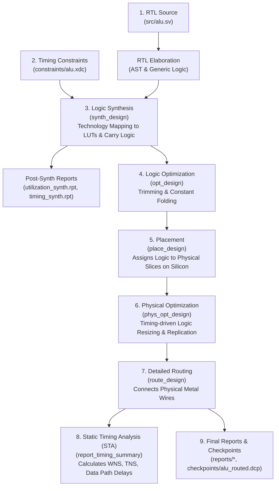

# Vivado Synthesis, Place & Route, and Static Timing Analysis (STA) Guide

A comprehensive, beginner-friendly walkthrough explaining the complete **RTL-to-Bitstream / RTL-to-GDSII** physical implementation flow for the 8-bit SystemVerilog ALU, mapping FPGA implementation in AMD/Xilinx Vivado to industry **ASIC Physical Design (PD)** concepts.

---

## 1. Flow Overview & Architecture

In physical implementation, writing RTL code is only the first step. The hardware compiler must translate, optimize, place, and route physical gates and interconnect wires while meeting timing and power constraints.



---

## 2. New Files Created & Why

To run physical design and timing analysis, we added three core files to the project:

### File 1: Timing Constraints (`constraints/alu.xdc`)

#### What is an XDC / SDC file?
In digital design, synthesis and place-and-route tools are **timing-driven**. Without constraints, the tool has no idea how fast the circuit must run and will perform random or minimal optimizations.

#### Why do we need a "Virtual Clock"?
In `alu.sv`, the ALU is purely combinational (there is no physical `clk` port on the module). In real chips, an ALU receives inputs from upstream registers and sends outputs to downstream registers. To analyze this combinational block using Static Timing Analysis (STA), we define a **Virtual Clock**:

```tcl
# 1. Define a 100 MHz reference virtual clock (Period = 10.0 ns)
create_clock -name vclk -period 10.000

# 2. Model external launch delay from upstream registers
set_input_delay -clock vclk 2.000 [get_ports {sel[*] A[*] B[*]}]

# 3. Model external capture setup requirement for downstream registers
set_output_delay -clock vclk 2.000 [get_ports {out[*]}]
```

#### The Timing Budget Equation
$$\text{Available Delay Budget } (T_{\text{comb}}) = T_{\text{period}} - T_{\text{input\_delay}} - T_{\text{output\_delay}} - T_{\text{uncertainty}}$$
$$\text{Available Delay Budget } (T_{\text{comb}}) = 10.000\,\text{ns} - 2.000\,\text{ns} - 2.000\,\text{ns} - 0.025\,\text{ns} = 5.975\,\text{ns}$$

This tells Vivado: **"The ALU's combinational logic and internal wires must compute from inputs to outputs within $5.975\,\text{ns}$ to run at $100\,\text{MHz}$."**

---

### File 2: Non-Project Batch Automation Script (`scripts/run_pnr.tcl`)

This TCL script automates the complete Vivado flow without requiring manual GUI clicking.

| Step in Script | Vivado TCL Command | What It Does Under the Hood |
|:---|:---|:---|
| **Step 1** | `read_verilog -sv`, `read_xdc` | Parses the SystemVerilog syntax and timing constraints into memory. |
| **Step 2** | `synth_design -top alu -part xc7a35tcpg236-1` | Compiles RTL into a gate-level netlist of Look-Up Tables (LUTs) and dedicated hardware carry chains (`CARRY4`). |
| **Step 3** | `opt_design` | Performs pre-placement optimization (prunes redundant logic, folds constants, optimizes inverter trees). |
| **Step 4** | `place_design` | Solves an NP-hard layout problem: maps each gate/LUT to an exact $(X, Y)$ coordinate on the silicon die to minimize interconnect distance. |
| **Step 5** | `phys_opt_design` | Post-placement optimization: replicates high-fanout nets and resizes cells along near-critical paths. |
| **Step 6** | `route_design` | Assigns and routes physical metal wire segments between placed slices, avoiding routing congestion and antenna violations. |
| **Step 7** | `report_*` & `write_checkpoint` | Dumps timing, utilization, power, and design checkpoints (`.dcp`) for visual inspection. |

---

### File 3: Execution Scripts

- **`run_synth_pnr.bat`**: A 1-click Windows batch file that invokes `vivado -mode batch -source scripts\run_pnr.tcl -nojournal -nolog`.
- **`Makefile` (`make syn`)**: Command-line build automation target for developers on Linux or Windows.

---

## 3. How to Execute the Flow

### Option A: From Windows Command Prompt / PowerShell
```powershell
.\run_synth_pnr.bat
```

### Option B: Using `make`
```bash
make syn
```

### Option C: Opening the Implemented Design in Vivado GUI
You can visually inspect the placed and routed hardware on the physical chip:
```bash
vivado checkpoints/alu_routed.dcp
```
Inside the Vivado GUI:
- **Device View**: Shows the physical Artix-7 die with the exact slices, LUTs, and interconnect wires colored in green/orange.
- **Schematic View**: Press `F4` to view the gate-level schematic netlist.
- **Timing Path Viewer**: Window $\rightarrow$ Timing $\rightarrow$ Double-click the critical path to see the physical route highlighted across the FPGA fabric.

---

## 4. In-Depth Results Analysis & Hardware Insights

All generated reports are stored in the [`reports/`](reports/) directory. Here is what the real data reveals:

### 1. Resource Utilization Analysis (`reports/utilization_route.rpt`)

| Resource Type | Used Count | Available on Chip | Utilization % | Architectural Purpose in ALU |
|:---|:---:|:---:|:---:|:---|
| **Slice LUTs** | **176** | 20,800 | 0.85% | Implements the 16:1 muxing, logic gates, and partial arithmetic stages |
| **Slice Registers (FFs)**| **0** | 41,600 | 0.00% | **0 FFs** because the design is purely combinational (no state retention) |
| **CARRY4 Primitives** | **32** | 8,150 | 0.39% | Dedicated fast look-ahead carry chains for addition, subtraction, and multi-stage division |
| **Bonded IOBs** | **28** | 106 | 26.42% | 4 (`sel`) + 8 (`A`) + 8 (`B`) + 8 (`out`) = 28 package pins |

> [!NOTE]
> Notice that **32 `CARRY4` primitives** were inferred even though addition is only 8 bits. Why? Because **division (`A / B`)** without pipelining is implemented in hardware as a sequence of repeated subtractors, requiring cascaded carry chains for every bit step!

---

### 2. Static Timing Analysis (STA) Deep-Dive (`reports/critical_path.rpt`)

The timing summary produced the following metrics against our $100\,\text{MHz}$ ($10.0\,\text{ns}$) virtual clock:

| Timing Metric | Value | What It Means |
|:---|:---:|:---|
| **WNS (Worst Negative Slack)** | **-13.581 ns** | The slowest path arrived $13.581\,\text{ns}$ later than the clock deadline. |
| **TNS (Total Negative Slack)** | **-69.656 ns** | The sum of negative slack across all 8 failing output bits (`out[7:0]`). |
| **WHS (Worst Hold Slack)** | **+6.077 ns** | Passed with substantial margin; no data race or short-path hold violations. |
| **Failing Endpoints** | **8 / 8** | All 8 output pins have negative slack due to the unpipelined division path. |

#### Critical Path Breakdown

- **Path Startpoint**: Port `B[0]`
- **Path Endpoint**: Port `out[0]`
- **Total Data Path Delay**: **$19.556\,\text{ns}$**
  - **Cell / Logic Delay**: $11.692\,\text{ns}$ (59.8%)
  - **Net / Routing Delay**: $7.864\,\text{ns}$ (40.2%)
- **Total Logic Levels**: **29 levels** (1 IBUF + 1 LUT5 + 1 LUT6 + **20 CARRY4** + 4 LUT3 + 1 LUT4 + 1 OBUF)

#### Why Did Timing Fail at 100 MHz?
Look at the logic levels: **20 cascaded `CARRY4` stages**!
In `src/alu.sv`, the expression `out = A / B` is purely combinational. The synthesizer creates a ripple-borrow array divider. The borrow signal must ripple through bit 7, down to bit 0, through 8 successive subtractor stages, before the final quotient bit reaches the output multiplexer.

#### Maximum Achievable Operating Frequency ($F_{\text{max}}$)
$$\text{Minimum Allowable Period } (T_{\text{min}}) = T_{\text{data\_path}} + T_{\text{input\_delay}} + T_{\text{output\_delay}} + T_{\text{uncertainty}}$$
$$T_{\text{min}} = 19.556\,\text{ns} + 2.000\,\text{ns} + 2.000\,\text{ns} + 0.025\,\text{ns} = 23.581\,\text{ns}$$
$$F_{\text{max}} = \frac{1}{23.581\,\text{ns}} \approx \mathbf{42.41\,\text{MHz}}$$

> [!TIP]
> If we targeted $40\,\text{MHz}$ ($25\,\text{ns}$ period), the ALU would meet timing with positive slack ($+1.419\,\text{ns}$).

---

### 3. Route Status & Power Estimation

- **Route Status (`reports/route_status.rpt`)**:
  - Routable nets: **206**
  - Fully routed nets: **206 (100%)**
  - Routing errors: **0**
- **Power Analysis (`reports/power.rpt`)**:
  - **Total On-Chip Power**: **$0.077\,\text{W}$ ($77\,\text{mW}$)**
  - Dynamic Power: $0.007\,\text{W}$ ($7\,\text{mW}$)
  - Device Static Power: $0.070\,\text{W}$ ($70\,\text{mW}$)
  - Junction Temperature: $25.4^\circ\text{C}$ (Safe, well within thermal limits)

---

## 5. ASIC Physical Design Interview Preparation

When interviewing for an **ASIC Physical Design (PD) or Static Timing Analysis (STA) Trainee/Junior Engineer** position, here is how you can discuss this project:

### Q1: "Walk me through how you implemented and analyzed this ALU."
> **Answer**:  
> *"I designed an 8-bit parameterized ALU in SystemVerilog and verified it with a self-checking testbench on Vivado `xsim`. To understand the physical implementation trade-offs, I pushed the design through a complete Vivado non-project batch flow: logical synthesis (`synth_design`), pre-placement optimization (`opt_design`), cell placement (`place_design`), physical optimization (`phys_opt_design`), and detailed metal routing (`route_design`). I constrained the design using a virtual clock at 100 MHz with realistic I/O delays and analyzed post-route utilization, power, and STA reports."*

### Q2: "What was the critical path in your design, and why?"
> **Answer**:  
> *"The critical path was between input `B[0]` and output `out[0]`, traversing 29 logic levels with a total data path delay of $19.56\,\text{ns}$ (60% logic delay, 40% interconnect routing delay). The bottleneck was the combinational division operation (`DIV`), which synthesized into 20 cascaded `CARRY4` carry-chain primitives for repeated subtraction. Because the available combinational budget at 100 MHz was $5.98\,\text{ns}$, the Worst Negative Slack (WNS) was $-13.58\,\text{ns}$."*

### Q3: "As a Physical Design engineer, how would you fix this timing violation?"
> **Answer**:  
> *"There are three primary architectural and physical solutions:*
> 1. *RTL Pipelining: Break the multi-stage division and multiplication into a 2-stage or 4-stage pipeline by inserting registers, transforming the long combinational path into shorter register-to-register paths.*
> 2. *Multi-Cycle Path (MCP) Constraints: If the enclosing processor architecture allows division to take 4 clock cycles, we can apply `set_multicycle_path -setup 4` from the inputs to the output.*
> 3. *Target Frequency Adjustment: For pure combinational execution, the maximum achievable frequency ($F_{\text{max}}$) is $42.4\,\text{MHz}$."*

### Q4: "Why did your design have 0 Flip-Flops in the utilization report?"
> **Answer**:  
> *"Because the ALU core is modeled purely combinationally using an `always_comb` block with a complete `unique case` statement. No registers were instantiated inside the module. All 176 utilized cells were Look-Up Tables (LUTs) and 32 `CARRY4` primitives, mapped across 28 package IOBs."*

---

## 6. Directory Structure with Flow Additions

```text
alu_systemverilog/
├── src/
│   └── alu.sv                   # Synthesizable SystemVerilog ALU RTL
├── tb/
│   └── alu_tb.sv                # Linear self-checking testbench
├── constraints/
│   └── alu.xdc                  # Timing constraints (virtual clock, input/output delays)
├── scripts/
│   └── run_pnr.tcl              # Vivado non-project batch synthesis & PnR script
├── reports/                     # Generated physical design & STA reports
│   ├── utilization_synth.rpt    # Post-synthesis resource utilization
│   ├── utilization_route.rpt    # Post-route resource utilization
│   ├── timing_synth.rpt         # Post-synthesis timing summary
│   ├── timing_summary_route.rpt # Post-route comprehensive STA summary
│   ├── critical_path.rpt        # Detailed critical path breakdown (delays, logic levels)
│   ├── route_status.rpt         # Routing completion verification (100% routed)
│   ├── drc.rpt                  # Design rule check report
│   └── power.rpt                # Total on-chip power estimation
├── checkpoints/                 # Design checkpoints for Vivado GUI inspection
│   ├── alu_synth.dcp            # Synthesized netlist checkpoint
│   ├── alu_placed.dcp           # Placed design checkpoint
│   └── alu_routed.dcp           # Fully routed design checkpoint
├── Makefile                     # Build automation (compile, run, syn, clean)
├── run_sim.bat                  # 1-Click simulation script
├── run_synth_pnr.bat            # 1-Click synthesis & implementation script
├── README.md                    # Main project documentation
└── SYNTHESIS_AND_PHYSICAL_DESIGN_GUIDE.md # This in-depth step-by-step guide
```
